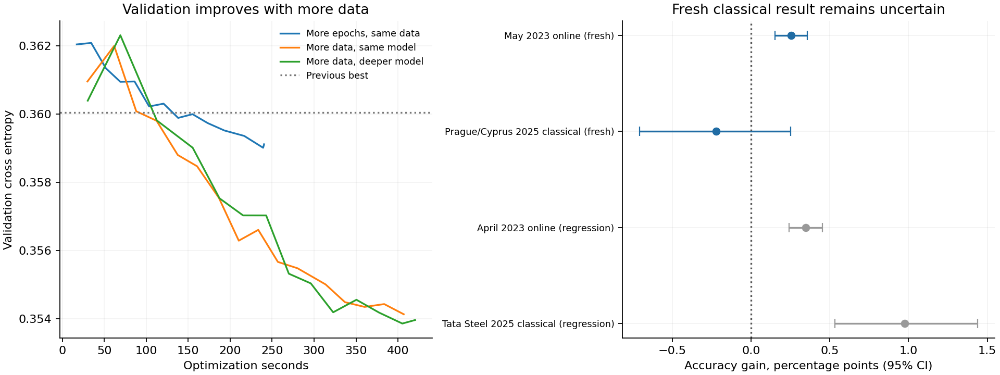

# Round 2 results: a modest online gain, mixed classical results

The existing **17,345-parameter model remains the default**. Eight new CPU training
runs and six weight averages produced a candidate with better online accuracy,
but it missed the predeclared requirement to improve on both fresh test sets.
The classical point estimate fell slightly; its confidence interval includes zero.
No model was retrained or reselected after these test results.

The useful deployment improvement ships independently: a lossless binary export
of the existing quantized model. Predictions are identical to its JSON export.

## Fresh tests and regression checks

Both columns use identical examples and INT8 deployment models. Fresh tests were
scored only after checkpoint and quantization freeze. Regression sets were
previously visible and were not selection targets.

| Test | Games | Decisions | Current default | Candidate | Gain (percentage points), 95% game-bootstrap CI |
|---|---:|---:|---:|---:|---:|
| May 2023 online (fresh) | 3,264 | 125,578 | 85.13% | 85.39% | +0.25 [+0.15, +0.36] |
| Prague/Cyprus 2025 classical (fresh) | 134 | 5,888 | 82.39% | 82.17% | -0.22 [-0.71, +0.25] |
| April 2023 online (regression) | 2,981 | 113,767 | 85.11% | 85.46% | +0.35 [+0.24, +0.45] |
| Tata Steel 2025 classical (regression) | 168 | 7,597 | 82.98% | 83.95% | +0.97 [+0.53, +1.44] |

Intervals resample whole games (2,000 paired bootstrap replicates). The online
gain is supported by the fresh-test interval; the classical difference is
uncertain. Regression improvements do not override the fresh-test adoption rule.

| Fresh test | Novel decisions | Default novel top-1 | Candidate novel top-1 | Candidate top-2 | Candidate float32 top-1 |
|---|---:|---:|---:|---:|---:|
| May 2023 online (fresh) | 103,819 | 83.29% | 83.53% | 98.89% | 85.41% |
| Prague/Cyprus 2025 classical (fresh) | 4,767 | 79.57% | 79.13% | 98.22% | 82.37% |

Novel means position+destination absent from all December/January training and
February development records. Complete game-sequence duplicates are excluded
across development and evaluation. Players/opening families may overlap.
Top-2 is coverage within the first two choices, not first-click accuracy.

The new classical sample comprises 45 Prague Masters, 45 Prague Challengers and
45 Cyprus Women's Grand Prix games; two Prague tiebreaks were excluded. Both-player
rating floor 2100 applies. Online Lichess ratings and over-the-board FIDE ratings
are not interchangeable. Promotion-piece selection and variants remain separate.

## Validation-guided search

Training grew from 826,387 to **1,227,149 ambiguous decisions**. All 400,762 added
December examples exclude every February validation game and position+destination.
The original 36,024-example novel validation contract stayed fixed.

| Trial | Parameters | Validation top-1 | Validation NLL | Best / completed epochs | Seconds |
|---|---:|---:|---:|---:|---:|
| incumbent-refine | 17,345 | 83.93% | 0.359017 | 13 / 14 | 240.9 |
| pooled-64-32 | 17,473 | 83.69% | 0.363300 | 12 / 12 | 242.1 |
| pooled-72-32 | 19,649 | 83.65% | 0.363396 | 13 / 13 | 240.6 |
| set-mean-warm | 13,633 | 83.74% | 0.363665 | 12 / 12 | 302.1 |
| set-mean-max | 18,785 | 83.24% | 0.369525 | 7 / 7 | 305.9 |
| december-incumbent | 17,345 | 84.19% | 0.354136 | 16 / 16 | 407.3 |
| december-wider-head | 18,913 | 84.05% | 0.354253 | 13 / 13 | 421.1 |
| december-deeper-head | 18,401 | 84.10% | 0.353864 | 13 / 14 | 421.0 |
| blend-refine-25 | 17,345 | 84.09% | 0.354969 | weight average | 0.6 |
| blend-refine-50 | 17,345 | 84.04% | 0.356131 | weight average | 0.4 |
| blend-refine-75 | 17,345 | 83.92% | 0.357475 | weight average | 0.4 |
| blend-deep-25 | 18,401 | 84.16% | 0.354498 | weight average | 0.4 |
| blend-deep-50 | 18,401 | 84.16% | 0.354692 | weight average | 0.5 |
| blend-deep-75 | 18,401 | 84.11% | 0.354394 | weight average | 0.6 |

These runs used 43.1 summed optimization/scoring minutes, excluding
preparation/startup; some ran concurrently. The December runs allowed 16 epochs
and 420 seconds, and some hit the time cap first. Architectural comparisons are
therefore exploratory, not strict equal-update causal studies. Input pooling,
learned mean/max pooling and weight averages did not win at these budgets.

The deepest candidate achieved the lowest validation NLL (0.353864), versus
0.354136 for the unchanged architecture. Their paired validation loss difference
was 0.000272, with a game-bootstrap
interval [-0.000365, 0.000908]. Applying the existing preference for a cheaper
model when results are effectively tied selected **december-incumbent**, preserving
17,345 parameters. This interval is descriptive after adaptive selection, not a
multiplicity-adjusted hypothesis test. The judgment preceded all fresh tests.

The chosen INT8 candidate had 84.10%
validation accuracy, versus 83.74% for the previous deployed model. Both per-tensor
and per-output quantization were compared on validation alone. Lowest NLL selected
per-output scaling; test feedback did not change that decision.

## Deployment size and latency

The default weights remain byte-for-byte unchanged. The new CCQ1 binary format
stores the same INT8 weights, float32 biases and scales as JSON.

| Current default artifact | Bytes |
|---|---:|
| Binary | 18,619 |
| Binary, gzipped | **16,755** |
| Previous JSON, gzipped | 23,696 |

Binary packing reduces the compressed download by
29.3%
without changing predictions. The candidate is optional under `candidate/`; it is
not installed as the default. Its binary is 18,618
bytes, or 16,677 gzipped.

Warm Node v24.22.1, Linux x64, 305 real/edge-case fixtures:

| Operation, current default | Median | p95 |
|---|---:|---:|
| rank_with_features_legal_moves_supplied | 0.151643 ms | 0.306497 ms |
| full_chessjs_legal_generation_and_ranking | 3.456028 ms | 6.261224 ms |
| cached_second_click | 0.000085 ms | 0.000113 ms |

Candidate feature-plus-ranking p95 was 0.354 ms.
Feature extraction is included; legal-move enumeration is measured separately.
Cached repeat clicks do not rerun inference. Excludes rendering, cold load, network
and history reconstruction. These are Node results, not mobile/browser guarantees.

## Verification and reproducibility

- 18 Python tests, including masked pooled-network gradients, candidate-order
  invariance, quantization and exact binary round trips.
- 305 Python/JavaScript feature and probability fixtures; exact binary/JSON
  prediction parity on all 305. Additional fixtures cover all three experimental
  architectures and both scalar/per-output quantization.
- Frozen hashes and data manifests retained; current default model hash matches
  the archived incumbent. No test-set retuning.
- Two concurrent preparation attempts exited 137 under heavy memory use, and
  another was interrupted before producing epoch results. The completed cache
  hashes were verified, construction was made exclusive/atomic, and configurations
  were restarted. See `infrastructure-attempts.json`.

See [README.md](README.md), [protocol.md](protocol.md), [selection.json](selection.json),
[final-evaluation.json](final-evaluation.json), and [adoption.json](adoption.json).
The prior study is preserved in [baseline/RESULTS.md](baseline/RESULTS.md).
Fresh tests are now public and must become regression sets for later research.
