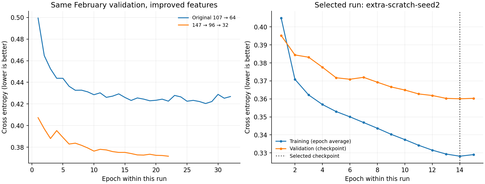

# Measured results: click-chess

Run: 2026-10-31. All accuracies concern destinations with **multiple legal origins**.
Promotion-piece selection remains a separate UI choice.

## Deployment model

147 candidate features → 96 → 32 ReLU units → 1 shared score.
**17,345 parameters**, including biases. The previous two plies are included.
The selected experiment is `extra-scratch-seed2`; selection used the fixed
36,024-example novel-position February validation set, not either fresh test set.

The deployment model is **23,696 bytes gzipped** (61,125 bytes
as JSON), using symmetric-int8-per-output. Weights are dequantized once at load;
inference uses floating-point arithmetic. No engine search or inference server.
Float32 and INT8 exports are both supplied. Validation accuracy is
83.72% for float32 and 83.74% for INT8.

## Fresh held-out comparison

Both versions are measured on identical examples. Baseline means the original
6,977-parameter INT8 model, preserved in `research/baseline/`. Models and export
choices were frozen before either fresh test was scored.

| Test | Games | Ambiguous examples | Baseline top-1 | Improved top-1 | Improved top-2 | Error reduction |
|---|---:|---:|---:|---:|---:|---:|
| Lichess Elite, April 2023 | 2,981 | 113,767 | 81.97% | **85.11%** | 98.77% | 17.43% |
| Tata Steel classical, 2025 | 168 | 7,597 | 80.56% | **82.98%** | 98.53% | 12.46% |

Paired accuracy gains, with 95% intervals from bootstrapping whole games:

- Lichess Elite, April 2023: +3.14 percentage points (95% CI 2.95–3.33).
- Tata Steel classical, 2025: +2.42 percentage points (95% CI 1.63–3.21).

Top-2 means the played origin appears among the first two choices. It does not
mean the first click was correct. Repeated clicks cycle the cached ranking.

| Test | Novel examples | Baseline novel top-1 | Improved novel top-1 | Float32 full top-1 | Mean choices, INT8 |
|---|---:|---:|---:|---:|---:|
| Lichess Elite, April 2023 | 94,626 | 79.94% | 83.37% | 85.13% | 1.162 |
| Tata Steel classical, 2025 | 6,263 | 77.79% | 80.54% | 83.02% | 1.186 |

Novel means position+destination absent from **both** February development data
and January extra training. Identical full move-sequence games are excluded
across development and tests. Players and opening families can still overlap.

The classical sample contains the 84 Masters and 84 Challengers records available
in the January/February 2025 broadcast archives. Three tiebreak games were
excluded. It is not a claim to contain every game of the tournaments. Both-player
rating floor 2100 applies; Lichess and FIDE ratings are not interchangeable.

## Research trials

The original baseline was reproduced exactly. The immutable novel validation set
contains 36,024 examples from 1,132 games. February training has 376,508 examples;
combined January/February training has 826,387. January excludes all February
validation games and position+destination keys before training. No classical
games enter training.

| Trial | Parameters | Validation top-1 | Validation NLL | Best / total epochs | Seconds |
|---|---:|---:|---:|---:|---:|
| baseline-recheck | 6,977 | 80.90% | 0.42037 | 28 / 32 | 70.8 |
| cosine-64 | 6,977 | 81.23% | 0.41477 | 49 / 51 | 120.1 |
| normalized-64 | 6,977 | 81.11% | 0.41889 | 46 / 54 | 120.2 |
| normalized-128 | 13,953 | 81.27% | 0.41756 | 17 / 36 | 120.2 |
| deep-64-32 | 9,025 | 81.69% | 0.40855 | 28 / 48 | 120.2 |
| deep-96-32 | 13,505 | 81.80% | 0.40915 | 16 / 36 | 117.3 |
| rich-64 | 9,537 | 83.05% | 0.37862 | 22 / 24 | 120.7 |
| rich-deep-64-32 | 11,585 | 83.19% | 0.37268 | 20 / 20 | 120.9 |
| rich-deep-96-32 | 17,345 | 83.36% | 0.37163 | 22 / 22 | 120.8 |
| rich-normalized-96-32 | 17,345 | 83.24% | 0.37321 | 10 / 30 | 110.3 |
| controlled-rich | 17,345 | 83.44% | 0.37172 | 22 / 24 | 111.1 |
| controlled-no-context | 17,345 | 83.29% | 0.37219 | 24 / 24 | 133.9 |
| controlled-no-risk | 17,345 | 81.49% | 0.40589 | 24 / 24 | 129.1 |
| extra-warm | 17,345 | 83.83% | 0.36279 | 13 / 13 | 240.9 |
| extra-scratch-seed2 | 17,345 | 83.72% | 0.36006 | 14 / 15 | 240.9 |
| extra-warm-refine | 17,345 | 83.74% | 0.36258 | 6 / 8 | 180.9 |

16 trials consumed 36.3 summed training minutes on CPU, excluding
data preparation/startup. Some ran concurrently, so this is not elapsed wall time.
The ordinary 120-second runs are not equal-update comparisons. Feature ablations
use the same seed, optimizer, architecture, data and 24 epochs. Their parameter
counts include zeroed input rows. The second combined-data run uses a different
seed from scratch; the other combined-data runs use warm starts. This is limited
seed evidence, not a multi-seed significance study.

The controlled comparisons show that board-wide material-risk features provide
most of the gain. Competing-origin context gives a smaller contribution. Width
alone was less useful. The trial log retains unsuccessful alternatives.

The best checkpoint is restored by validation NLL. Training loss can continue to
fall after validation stops improving; the plot is evidence about this bounded
search, not proof of a global optimum. Further progress may require better
features, more varied games or distillation rather than simply training longer.

## Latency

Warm v24.22.1, linux x64,
305 real/edge-case fixtures. CPU: unavailable.

| Operation | Median | p95 | p99 |
|---|---:|---:|---:|
| rank_with_features_legal_moves_supplied | 0.172129 ms | 0.401344 ms | 0.762034 ms |
| full_chessjs_legal_generation_and_ranking | 3.826540 ms | 7.233658 ms | 11.222060 ms |
| cached_second_click | 0.000084 ms | 0.000136 ms | 0.000242 ms |

Feature extraction is included in ranking. Legal-move enumeration is measured
separately; reuse the UI's legal list when possible. Cached repeat clicks do not
run the network. Excludes UI rendering, cold model load and history reconstruction.
These are Node measurements, not browser/mobile latency guarantees.

## Verification and limits

- 14 Python tests cover legality, castling, en passant, promotions, history,
  canonical reconstruction, loss gradient, normalization folding and quantization.
- 305 Python/JavaScript fixtures check both feature versions and float32/INT8
  ranking/probability parity, including 200 additional real-game positions. Probability
  tolerance is 1e-4; feature tolerance is 1e-6.
- Quantization is selected using validation alone, allowing at most 0.2 percentage
  points of validation accuracy loss. Frozen hashes are checked before testing.
- Source hashes, trial settings, curves and data manifests are published. The
  source-commit fields identify local experiment commits; exact runner snapshots
  are also retained under `research/source-snapshots/` for hash verification.
- This predicts choices in strong-player games, not an individual's guaranteed
  intent. No measured novice, Chess960, other-variant or promotion-piece accuracy.
- Softmax probabilities are not separately calibrated. Keep corrections easy.
- The old no-history model remains an optional fallback; these new results concern
  the history-enabled model. The original results are archived under
  `research/baseline/RESULTS.md`; they use different tests and must not be compared
  directly with the new test columns.

See [research/README.md](../../README.md) for reproduction and [program.md](../../../program.md)
for the experiment contract. The fresh tests are now public and should serve as
regression sets in subsequent research, with another unseen final test reserved.
